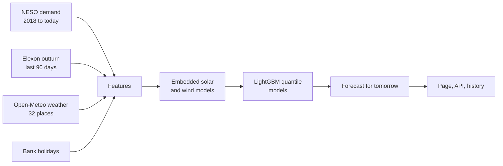

# UK Energy Demand Forecast

[](https://github.com/EgeErenler/uk-energy-forecast/actions/workflows/ci.yml)
[](https://github.com/EgeErenler/uk-energy-forecast/actions/workflows/daily.yml)

A day-ahead forecast of Great Britain's electricity demand, every half hour, with an 80% range.
It is compared with the official forecast from NESO, the national system operator.

**Live page: [egeerenler.com/uk-energy-forecast](https://egeerenler.com/uk-energy-forecast/)**

## Results

Backtest from January 2025 to September 2026 (30,568 half hours). The model was trained only
on data before 2025 and saw **weather forecasts made the day before**, as it would live.

| Forecast | Average error (MAPE) |
|---|---:|
| NESO official day-ahead forecast | 2.93% |
| **This model** | **3.17%** |
| Seasonal naive (same half hour last week) | 8.52% |

The model is within a quarter of a point of NESO, which uses far more data, and it beats NESO
on about 4 days in 10. With observed weather instead of forecasts it scores 2.89%, slightly
better than NESO, which shows how much of the remaining gap is the weather forecast itself.

Every forecast the daily job publishes is also saved before the day starts and scored
afterwards, so the live page builds a real track record, not only a backtest.

## How it works



1. **Data.** Half-hourly National Demand since 2018 and NESO's own day-ahead forecast (NESO
   open data). NESO's files arrive about three weeks late, so the newest days come from
   Elexon's initial demand outturn, calibrated on the days both cover (0.09% difference).
2. **Weather.** Open-Meteo for 32 places in three groups: eight cities weighted by population
   (heating and lighting), twelve solar regions (sunshine) and twelve wind regions (wind at
   100 m). History comes from the ERA5 archive; the forecast for tomorrow from the forecast API.
3. **Hidden generation.** Rooftop solar and small wind farms lower the demand the grid sees.
   Two models learn their output, as a share of installed capacity, from the weather. The main
   model then works with the smoother underlying demand, and the estimate is taken away at the
   end. This step cut the error by about a quarter.
4. **Features.** Time of day, day of week, bank holidays, season, temperature and how it
   compares with recent days, and underlying demand from 2, 7 and 14 days before, all relative
   to its recent 7-day level. Full days are at least two days old, because the forecast is made
   on the morning before. Only last night's demand is newer.
5. **Model.** Three LightGBM models with a quantile loss (10th, 50th, 90th percentile). Early
   stopping on the newest 10% of the training data picks the number of trees, and conformal
   calibration on the same data widens the 80% range. Each training run is logged with MLflow.
6. **Daily job.** GitHub Actions fetches the new data, retrains, forecasts tomorrow, saves the
   forecast to the `history` branch and publishes the page.

## Design choices

- **Predicting a ratio, not megawatts.** GB demand has fallen for years. Tree models cannot
  extrapolate a trend, so the model predicts demand as a multiple of its recent level.
- **A fair test.** The test period uses weather forecasts issued a day earlier (Open-Meteo
  Previous Runs API), not the weather that happened, and both forecasts are scored against
  NESO's own published outturn.
- **Clock changes.** Days have 46, 48 or 50 settlement periods. All joins use the UTC start of
  each half hour, and the tests cover both clock-change days.
- **Honest ranges.** In the test period the 80% range held about 67% of outcomes. It is too
  narrow on sunny summer days, when the embedded solar estimate is least certain. The page
  shows the measured coverage next to the chart.

## The API

```bash
docker build -t energyforecast .
docker run -p 8000:8000 \
  -v "$PWD/artifacts:/app/artifacts" -v "$PWD/data/clean:/app/data/clean" energyforecast
```

| Endpoint | Returns |
|---|---|
| `GET /health` | Status and whether a model is loaded |
| `GET /forecast/latest` | The newest published forecast |
| `GET /forecast?day=YYYY-MM-DD` | A forecast for any day with a weather forecast |
| `GET /model` | Training date, features and backtest metrics |
| `GET /docs` | Interactive documentation |

CI builds the image, trains a model on sample data inside it, starts the API and calls it.

## Run it yourself

```bash
pip install -e ".[dev]"

energyforecast sample      # synthetic data, no downloads
energyforecast train
energyforecast forecast
energyforecast site        # writes site/index.html
energyforecast serve       # http://127.0.0.1:8000/docs

energyforecast fetch       # or download the real data (a few minutes)
```

MLflow runs are written to `./mlruns`. To browse them: `pip install mlflow && mlflow ui`.

## Tests

```bash
pytest
```

The tests cover settlement periods on clock-change days, every date format in the NESO files,
the population weighting of weather, the Elexon calibration, that no demand feature looks into
the forecast day, the order of the quantiles, that a published forecast is never overwritten,
an end-to-end training run on sample data, and the API.

## Project layout

```
src/energyforecast/
  sources/      NESO demand and forecast, Elexon, Open-Meteo, bank holidays
  features.py   calendar, weather and demand features
  embedded.py   embedded solar and wind models
  model.py      quantile models, conformal calibration, backtest, metrics
  pipeline.py   train, forecast, keep the history
  report.py     the static page
  api.py        FastAPI service
tests/
Dockerfile
```

## Data and licences

NESO data under the NESO Open Data Licence. Elexon BMRS data under the BSC Open Data Licence.
Weather data by [Open-Meteo.com](https://open-meteo.com/) (CC BY 4.0). Bank holidays from
GOV.UK under the Open Government Licence.

## Author

Ege Erenler · [egeerenler.com](https://egeerenler.com) · [LinkedIn](https://www.linkedin.com/in/ege-erenler)
